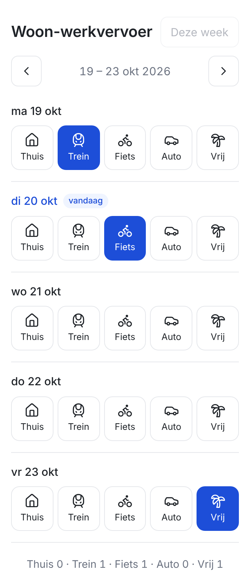

# Woon-werkvervoer

Leg per werkdag met één tik vast hoe je naar je werk bent gegaan: thuis, trein, fiets, auto of vrij.
De specificatie staat in [SPEC.md](SPEC.md).

De app staat online op https://steenmetzg.github.io/woon-werkvervoer/



## Starten op je computer

Je hebt [Node.js](https://nodejs.org) nodig (versie 20 of nieuwer). Open een terminal in deze map en typ:

```
npm install
npm run dev
```

Open daarna het adres dat verschijnt (meestal http://localhost:5173).

## Handige opdrachten

| Opdracht | Wat het doet |
|----------|--------------|
| `npm run dev` | Start de app om te bekijken en aan te werken. |
| `npm test` | Draait de automatische tests van alle acceptatiecriteria. |
| `npm run build` | Maakt de versie om online te zetten, in de map `dist`. |

## Op je telefoon

Elke wijziging op de branch `main` wordt automatisch getest en online gezet via GitHub Pages. Open het adres op je telefoon en kies
"Zet op beginscherm" (iPhone: deelknop, Android: menu met drie puntjes). De app opent dan schermvullend.

Je keuzes worden alleen op die telefoon bewaard. Als je de websitegegevens van je browser wist, zijn ze weg.

## Opbouw

- `src/App.tsx`: het scherm met de week, de knoppen en de totalen
- `src/dates.ts`: rekenen met datums (maandag van de week, Nederlandse namen)
- `src/storage.ts`: bewaren en ophalen van keuzes in de browser
- `src/index.css`: de vormgeving
- `src/App.test.tsx`: de tests, één groep per acceptatiecriterium
- `public/`: app-icoon en manifest voor "Zet op beginscherm"
